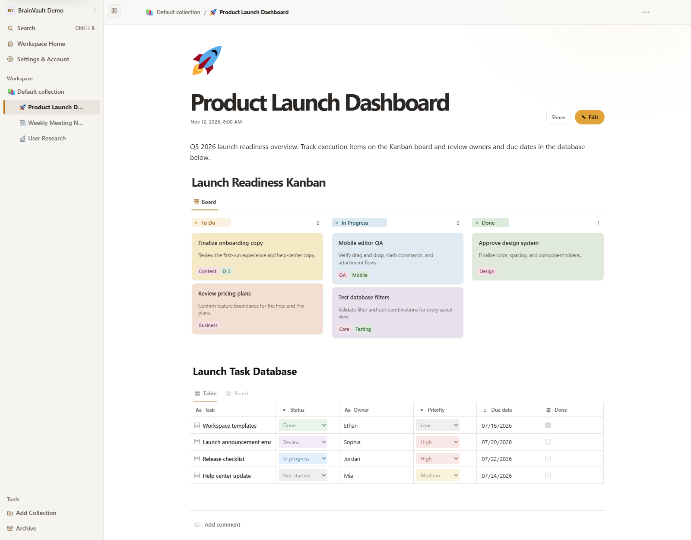

[English](README.md) | [한국어](README.ko.md) | **日本語**

# BrainVault — セルフホスト型ブロックベースノートWebアプリ

BrainVaultは、Node.js、Express、TypeScript、MariaDBで構築された**セルフホスト型のブロックベースノートWebアプリ**です。ブラウザ上でノートやドキュメントを作成・整理・検索でき、Yjsを利用したリアルタイム共同編集、ページ／コレクション共有、REST API連携に対応しています。



## 主な機能

- ネストされたコンテンツ、ドラッグ＆ドロップによる並べ替え(メニューやキーボードでも可能)、スラッシュコマンド、テーブル、データベース、カンバンボード、ガントタイムライン、リスト、トグル、ツリービューに対応したブロックエディター
- キーボード中心の編集: `Enter`でカーソル位置からブロックを分割し、新しいブロックの作成中に入力した文字もそのまま移動、先頭で`Backspace`を押すと上のブロックと結合、矢印キーでブロック間を移動、`Ctrl/Cmd + Shift + ↑/↓`で並べ替え、選択テキストで`Ctrl/Cmd + K`を押すとリンクを挿入、コードブロック内では`Enter`で改行
- テキストブロックの削除時は確認ダイアログの代わりに元に戻す操作を表示
- リッチテキスト、Markdown、シンタックスハイライト付きコード、コールアウト、ブックマーク、動画、添付ファイル、AIチャットブロック、数式、Mermaidダイアグラム
- ページは既定で閲覧モードで開き、**編集**ボタンを押したときだけ編集モードに切り替わるため、誤クリックや誤入力でノートが変更されない。必要なら**設定 → 環境設定**で書き込みモードで開くように変更可能。自動保存の状態表示、`Ctrl/Cmd + S`、ブラウザーの戻る／進むに対応
- 名前の変更やサイドバー行のドラッグで並べ替えができるページコレクション、ネストされたページ、カスタムアイコンとカバー、ワンクリックでアーカイブして元に戻せるアーカイブ機能とアーカイブからの復元、一緒に削除される下位ページ数を示す完全削除、バージョン履歴、PDFエクスポート、ZIPバックアップ／復元
- ライト、ダーク、システム設定に合わせるテーマ
- Yjsベースのリアルタイム共同編集に対応したページ共有とコレクション共有、コメントパネルを開いている間は新しいコメントを自動で読み込むページコメント
- ブラウザ下書きと共同編集内容のクラッシュ／競合復旧サポート。復元した下書きがサーバー版と競合した場合は、入力を続ける前に**自分の版を残す**で解決可能
- ページタイトルとブロック内容を対象とした全文検索。入力中に結果が更新され、次の検索を読み込む間も前の結果が表示されたまま
- JWT認証、IPごとの試行回数制限(24時間ブロック)を選択できるTOTP MFA、WebAuthn/FIDO2パスキー、ログイン制御、プロフィール設定
- IDとパスワードのルールを事前に表示し、管理者の承認後にのみ新しいアカウントを有効にするサインアップ
- 英語、日本語、韓国語、フランス語、ドイツ語、スペイン語、ポルトガル語の7つのUI言語
- 非公開の添付ファイルストレージ、サニタイズ済みMarkdownレンダリング、レート制限、ブックマークプレビュー検証

## 技術スタック

| 領域 | 技術 |
| --- | --- |
| ランタイム | Node.js, Express 5, TypeScript |
| データベース | MariaDB |
| フロントエンド | Vanilla HTML, CSS, JavaScript, Yjs |
| 認証 | JWT, bcrypt, TOTP, WebAuthn/FIDO2 |
| 検証／レンダリング | Zod, markdown-it, sanitize-html, KaTeX |
| テスト | Vitest, Supertest, Node test runner |

サポートされるNode.jsのバージョンは`package.json`に定義されています。

## インストールとクイックスタート

サポート対象のNode.jsバージョン、npm 10.9以降、および接続可能なMariaDBサーバーが必要です。

```bash
npm run db:configure
npm install
npm run setup
npm run dev
```

`npm run setup`は、環境、データベース、マイグレーションを準備します。デモワークスペースも含める場合は、次のコマンドを使用してください。

```bash
npm run setup:demo
```

開発コマンドはデフォルトで`http://localhost:4000`上にBrainVaultを起動し、サーバーの準備が完了するとプライベート／シークレットブラウザーウィンドウを開きます。

## よく使うコマンド

```bash
npm run dev                # 開発サーバーを起動
npm run build              # TypeScriptサーバーをビルド
npm test                   # メインのテストスイートを実行
npm run test:watch         # watchモードでユニットテストを実行
npm run verify:security    # セキュリティ重点チェックを実行
npm run verify:data-loss   # 永続化と復旧の保護チェックを実行
npm run verify:collaboration # 共同編集チェックを実行
npm run db:migrate         # データベースマイグレーションを適用
npm run db:seed            # デモデータを追加
npm run registration:approve -- <username>
```

変更をデプロイする前に、少なくとも次のコマンドを実行してください。

```bash
npm run build
npm test
npm run verify:security
```

データベースまたはブラウザーに依存する動作については、実際のデプロイ先環境でも確認してください。

## 添付ファイルの保存とデータ管理

添付ファイルは公開Webルートの外部に保存されます。デフォルトの添付ファイルディレクトリは`uploads/`です。本番環境では永続ストレージ上に保持してください。

カスタムアイコンファイルはアプリの`/upload/icons/...`保存パスを使用し、生成された参照値によってMariaDBで追跡されます。インストール環境を移行または復元する際は、対応するアップロードデータとデータベースをまとめて保持してください。

## ページ共有とリアルタイム共同編集

個別のページを直接共有できます。カスタムコレクションも`READ`、`WRITE`、`ADMIN`権限で共有でき、コレクション内のページはそのコレクション権限を継承します。

共有ドキュメントはYjsを使用してリアルタイムに更新され、MariaDBへ永続化されます。共同編集機能を正しく動作させるには、リバースプロキシでWebSocketアップグレードを許可する必要があります。

権限の詳細、再接続動作、プロキシ設定については、共同編集ガイドを参照してください。

## HTTPSデプロイ

BrainVaultは、Posh-ACMEの証明書ファイルを使用してHTTPSを直接終端することも、Caddy、Synology DSM、NGINX、Nginx Proxy Managerなどの信頼できるリバースプロキシの背後で実行することもできます。

例については[HTTPSデプロイガイド](deploy/README.jp.md)を参照してください。

## プロジェクトドキュメント

| ガイド | 内容 |
| --- | --- |
| [ドキュメントインデックス](docs/README.jp.md) | 主要ドキュメントへのリンク |
| [はじめに](docs/getting-started/2026-07-27/getting-started.ja.md) | インストール、データベース設定、デモデータ、本番環境設定 |
| [設定](docs/configuration/2026-07-28/configuration.ja.md) | 環境変数とランタイムオプション |
| [機能](docs/features/2026-07-30/features.ja.md) | エディター、ブロック、バックアップ／復元、エクスポート、言語 |
| [共同編集](docs/collaboration/2026-07-29/collaboration.ja.md) | 共有、Yjs/WebSocketフロー、永続化 |
| [コレクション共有](docs/collaboration/2026-09-02/collection-sharing.ja.md) | コレクション権限と継承 |
| [セキュリティ](docs/security/2026-07-30/security.ja.md) | 認証、シークレット、添付ファイル、本番環境のセキュリティ境界 |
| [API](docs/api/2026-07-30/api.ja.md) | REST API概要 |
| [OpenAPI](docs/api/2026-07-30/openapi.yaml) | OpenAPI 3.1仕様 |
| [開発](docs/development/2026-07-28/development.ja.md) | プロジェクト構成、スクリプト、翻訳、プレビューキャプチャ |

## 開発上の注意

lockfileはコミットされ、プロジェクトのスクリプトによってチェックされます。ロックされた依存関係のバージョンをそのまま使ってクリーンインストールする場合は、`npm ci`を使用してください。

ブラウザUIは`public/`、サーバーコードは`src/`、スキーマ変更は`migrations/`、自動テストは`tests/`にあります。`scripts/`配下のユーティリティスクリプトには、セットアップヘルパーやテストスイートで使用される回帰テスト用フィクスチャが含まれています。
