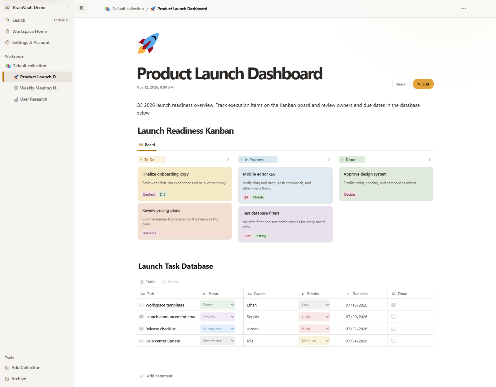

[English](README.md) | **한국어** | [日本語](README.jp.md)

# BrainVault — 셀프호스팅 블록 기반 노트 웹앱

BrainVault는 Node.js, Express, TypeScript, MariaDB로 구축한 **셀프호스팅 블록 기반 노트 웹앱**입니다. 브라우저에서 노트와 문서를 작성·정리·검색할 수 있고, Yjs 기반 실시간 협업과 페이지·컬렉션 공유, REST API 연동을 지원합니다.



## 주요 기능

- 중첩 콘텐츠, 드래그 앤 드롭 정렬(메뉴와 키보드로도 가능), 슬래시 명령, 표, 데이터베이스, 칸반 보드, 간트 타임라인, 목록, 토글, 트리 뷰를 지원하는 블록 편집기
- 키보드 중심 편집: `Enter`는 커서 위치에서 블록을 나누고 새 블록이 생기는 동안 입력한 글자도 그대로 옮김, 맨 앞에서 `Backspace`로 윗 블록과 합치기, 방향키로 블록 간 이동, `Ctrl/Cmd + Shift + ↑/↓`로 순서 변경, 선택한 텍스트에서 `Ctrl/Cmd + K`로 링크 삽입, `Ctrl/Cmd + Shift + X`와 `Ctrl/Cmd + E`로 취소선과 인라인 코드 적용, 코드 블록 안에서는 `Enter`로 줄바꿈
- 텍스트 블록 삭제 시 확인창 대신 실행 취소 제공
- 리치 텍스트, Markdown, 구문 강조 코드, 콜아웃, 북마크, 동영상, 첨부파일, AI 채팅 블록, 수식, Mermaid 다이어그램
- 페이지는 기본적으로 읽기 모드로 열리고 **편집** 버튼을 눌러야 편집 모드로 전환되어, 실수로 클릭하거나 입력해도 노트가 바뀌지 않음. 원하면 **설정 → 환경설정**에서 쓰기 모드로 열리도록 바꿀 수 있음. 자동 저장 상태 표시, `Ctrl/Cmd + S`, 브라우저 뒤로/앞으로 이동 지원. 읽기 모드에서는 Tab 키가 읽기 전용 블록 필드를 건너뛰고, 로그아웃 전에 확인을 거침
- 이름을 바꾸고 사이드바 행을 끌어 순서를 바꿀 수 있는 페이지 컬렉션, 가장자리를 끌어 너비를 조절할 수 있는 사이드바, 중첩 페이지, 사용자 지정 아이콘과 커버, 클릭 한 번으로 보관하고 실행취소할 수 있는 보관 기능과 보관함에서 복원, 함께 삭제되는 하위 페이지 수를 알려주는 영구 삭제, 버전 기록, PDF 내보내기, ZIP 백업 및 복원
- 라이트, 다크, 시스템 설정 따르기 테마
- Yjs 기반 실시간 협업을 지원하는 페이지 공유 및 컬렉션 공유, 댓글 패널을 열어 두면 새 댓글을 자동으로 불러오는 페이지 댓글
- 브라우저 초안과 공동 편집 내용을 위한 장애·충돌 복구 지원. 복구한 초안이 서버 버전과 충돌하면 입력을 이어가기 전에 **내 버전 유지**로 해결 가능
- 페이지 제목과 블록 콘텐츠 전체 검색. 입력하는 동안 결과가 갱신되고, 다음 검색을 불러오는 동안에도 기존 결과가 유지됨
- JWT 인증, IP별 시도 횟수 제한(24시간 차단)을 선택할 수 있는 TOTP MFA, WebAuthn/FIDO2 패스키, 로그인 제어, 프로필 설정
- 아이디·비밀번호 규칙을 미리 안내하고, 관리자가 승인한 뒤에만 새 계정을 활성화하는 회원가입
- 영어, 일본어, 한국어, 프랑스어, 독일어, 스페인어, 포르투갈어 등 7개 UI 언어
- 비공개 첨부파일 저장소, 정제된 Markdown 렌더링, 요청 속도 제한, 북마크 미리보기 검증

## 기술 스택

| 영역 | 기술 |
| --- | --- |
| 런타임 | Node.js, Express 5, TypeScript |
| 데이터베이스 | MariaDB |
| 프론트엔드 | Vanilla HTML, CSS, JavaScript, Yjs |
| 인증 | JWT, bcrypt, TOTP, WebAuthn/FIDO2 |
| 검증/렌더링 | Zod, markdown-it, sanitize-html, KaTeX |
| 테스트 | Vitest, Supertest, Node test runner |

지원되는 Node.js 버전은 `package.json`에 정의되어 있습니다.

## 설치 및 빠른 시작

지원되는 Node.js 버전, npm 10.9 이상, 접속 가능한 MariaDB 서버가 필요합니다.

```bash
npm run db:configure
npm install
npm run setup
npm run dev
```

`npm run setup`은 환경, 데이터베이스, 마이그레이션을 준비합니다. 데모 워크스페이스도 포함하려면 다음 명령을 사용하세요.

```bash
npm run setup:demo
```

개발 명령은 기본적으로 `http://localhost:4000`에서 BrainVault를 시작하며, 서버가 준비되면 비공개/시크릿 브라우저 창을 엽니다.

## 자주 사용하는 명령

```bash
npm run dev                # 개발 서버 시작
npm run build              # TypeScript 서버 빌드
npm test                   # 기본 테스트 스위트 실행
npm run test:watch         # watch 모드로 단위 테스트 실행
npm run verify:security    # 보안 중심 검사 실행
npm run verify:data-loss   # 영속성 및 복구 보호 검사 실행
npm run verify:collaboration # 협업 검사 실행
npm run db:migrate         # 데이터베이스 마이그레이션 적용
npm run db:seed            # 데모 데이터 추가
npm run registration:approve -- <username>
```

변경 사항을 배포하기 전에 최소한 다음 명령을 실행하세요.

```bash
npm run build
npm test
npm run verify:security
```

데이터베이스 또는 브라우저에 의존하는 동작은 실제 배포 대상 환경에서도 확인해야 합니다.

## 첨부파일 저장 및 데이터 관리

첨부파일은 공개 웹 루트 외부에 저장됩니다. 기본 첨부파일 디렉터리는 `uploads/`이며, 운영 환경에서는 영구 저장소에 보관하세요.

사용자 지정 아이콘 파일은 앱의 `/upload/icons/...` 저장 경로를 사용하고, 생성된 참조값으로 MariaDB에서 추적됩니다. 설치 환경을 이전하거나 복원할 때는 관련 업로드 데이터와 데이터베이스를 함께 보관하세요.

## 페이지 공유 및 실시간 협업

개별 페이지를 직접 공유할 수 있습니다. 사용자 지정 컬렉션도 `READ`, `WRITE`, `ADMIN` 권한으로 공유할 수 있으며, 컬렉션 안의 페이지는 해당 컬렉션 권한을 상속합니다.

공유 문서는 Yjs를 사용해 실시간으로 업데이트되고 MariaDB에 영속적으로 저장됩니다. 협업 기능이 정상적으로 작동하려면 리버스 프록시가 WebSocket 업그레이드를 허용해야 합니다.

권한 세부사항, 재연결 동작, 프록시 설정은 협업 가이드를 참고하세요.

## HTTPS 배포

BrainVault는 Posh-ACME 인증서 파일을 사용해 HTTPS를 직접 종료하거나, Caddy, Synology DSM, NGINX, Nginx Proxy Manager 같은 신뢰할 수 있는 리버스 프록시 뒤에서 실행할 수 있습니다.

예시는 [HTTPS 배포 가이드](deploy/README.ko.md)를 참고하세요.

## 프로젝트 문서

| 가이드 | 내용 |
| --- | --- |
| [문서 인덱스](docs/README.ko.md) | 주요 문서 링크 |
| [시작하기](docs/getting-started/2026-07-27/getting-started.ko.md) | 설치, 데이터베이스 설정, 데모 데이터, 운영 환경 설정 |
| [설정](docs/configuration/2026-07-28/configuration.ko.md) | 환경 변수와 런타임 옵션 |
| [기능](docs/features/2026-07-30/features.ko.md) | 편집기, 블록, 백업/복원, 내보내기, 언어 |
| [협업](docs/collaboration/2026-07-29/collaboration.ko.md) | 공유, Yjs/WebSocket 흐름, 영속성 |
| [컬렉션 공유](docs/collaboration/2026-09-02/collection-sharing.ko.md) | 컬렉션 권한과 상속 |
| [보안](docs/security/2026-07-30/security.ko.md) | 인증, 비밀값, 첨부파일, 운영 환경 보안 경계 |
| [API](docs/api/2026-07-30/api.ko.md) | REST API 개요 |
| [OpenAPI](docs/api/2026-07-30/openapi.yaml) | OpenAPI 3.1 명세 |
| [개발](docs/development/2026-07-28/development.ko.md) | 프로젝트 구조, 스크립트, 번역, 미리보기 캡처 |

## 개발 참고사항

lockfile은 커밋되어 있으며 프로젝트 스크립트에서 검사합니다. 잠긴 의존성 버전을 그대로 사용해 깨끗하게 설치하려면 `npm ci`를 사용하세요.

브라우저 UI는 `public/`, 서버 코드는 `src/`, 스키마 변경은 `migrations/`, 자동화 테스트는 `tests/`에 있습니다. `scripts/` 아래의 유틸리티 스크립트에는 설정 도우미와 테스트 스위트에서 사용하는 회귀 테스트 픽스처가 포함되어 있습니다.
