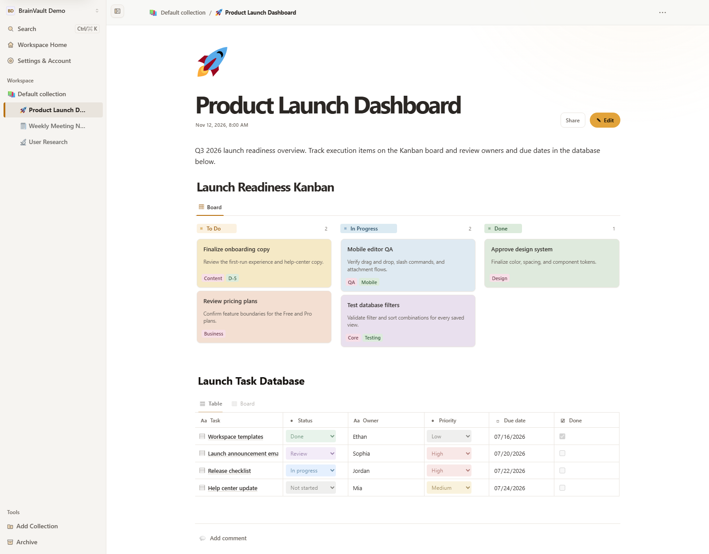

**English** | [한국어](README.ko.md) | [日本語](README.jp.md)

# BrainVault

BrainVault is a self-hosted block-based notes app built with Node.js, Express, TypeScript, and MariaDB. It runs as a browser workspace and also exposes a REST API for integrations or other clients.



## What it includes

- Block editor with nested content, drag-and-drop ordering with menu and keyboard alternatives, slash commands, tables, databases, Kanban boards, Gantt timelines, lists, toggles, and tree views
- Keyboard-first editing: `Enter` splits a block at the caret and keeps anything typed while the new block is created, `Backspace` at the start joins the block above, arrow keys move between blocks, `Ctrl/Cmd + Shift + ↑/↓` reorders, `Ctrl/Cmd + K` turns selected text into a link, and `Enter` types a line break inside code blocks
- Deleting a text block offers an undo action instead of a confirmation prompt
- Rich text, Markdown, syntax-highlighted code, callouts, bookmarks, videos, attachments, AI chat blocks, formulas, and Mermaid diagrams
- Pages open in read mode by default and switch to editing with an explicit **Edit** button, so a stray click or keystroke cannot change a note; accounts that prefer it can open pages in write mode from **Settings → Preferences**. An autosave indicator, `Ctrl/Cmd + S`, and browser Back/Forward navigation are supported
- Page collections that can be renamed and reordered by dragging their sidebar rows, a sidebar that can be resized by dragging its edge, nested pages, custom icons and covers, one-click archiving with an undo action and an archive view for restoring pages, permanent deletion that states how many nested pages it removes, version history, PDF export, and ZIP backup/restore
- Light, dark, and match-system themes
- Page sharing and collection sharing with Yjs-based live collaboration, plus page comments that load new replies automatically while the comment panel is open
- Crash-recovery support for browser drafts and collaborative edits, with a **Keep my version** action for resolving a recovered draft before you continue typing
- Search across page titles and block content, with results that update as you type and stay on screen while the next query loads
- JWT authentication, TOTP MFA with an optional per-IP attempt limit (24-hour block), WebAuthn/FIDO2 passkeys, login controls, and profile settings
- Sign-up that shows the ID and password rules up front and activates new accounts only after administrator approval
- Seven UI languages: English, Japanese, Korean, French, German, Spanish, and Portuguese
- Private attachment storage, sanitized Markdown, rate limiting, and bookmark preview validation

## Stack

| Area | Technology |
| --- | --- |
| Runtime | Node.js, Express 5, TypeScript |
| Database | MariaDB |
| Frontend | Vanilla HTML, CSS, JavaScript, Yjs |
| Authentication | JWT, bcrypt, TOTP, WebAuthn/FIDO2 |
| Validation/rendering | Zod, markdown-it, sanitize-html, KaTeX |
| Tests | Vitest, Supertest, Node test runner |

Supported Node.js versions are defined in `package.json`.

## Quick start

You need a supported Node.js version, npm 10.9 or newer, and a reachable MariaDB server.

```bash
npm run db:configure
npm install
npm run setup
npm run dev
```

`npm run setup` prepares the environment, database, and migrations. To include the demo workspace, use:

```bash
npm run setup:demo
```

The development command starts BrainVault on `http://localhost:4000` by default and opens it in a private/incognito browser window after the server is ready.

## Common commands

```bash
npm run dev                # Start the development server
npm run build              # Build the TypeScript server
npm test                   # Run the main test suite
npm run test:watch         # Run unit tests in watch mode
npm run verify:security    # Run the security-focused checks
npm run verify:data-loss   # Run persistence and recovery guards
npm run verify:collaboration # Run collaboration checks
npm run db:migrate         # Apply database migrations
npm run db:seed            # Add demo data
npm run registration:approve -- <username>
```

Before deploying a change, run at least:

```bash
npm run build
npm test
npm run verify:security
```

Database- or browser-dependent behavior should also be checked in the target deployment environment.

## Storage

Attachments are stored outside the public web root. The default attachment directory is `uploads/`; keep it on persistent storage in production.

Custom icon files use the app's `/upload/icons/...` storage path and are tracked in MariaDB by generated references. Keep the corresponding upload data together with the database when moving or restoring an installation.

## Sharing and collaboration

Individual pages can be shared directly. Custom collections can also be shared with `READ`, `WRITE`, or `ADMIN` access, and pages inside the collection inherit that collection access.

Shared documents use Yjs for live updates and persist through MariaDB. Reverse proxies must allow WebSocket upgrades for collaboration to work correctly.

See the collaboration guides for permission details, reconnect behavior, and proxy configuration.

## HTTPS

BrainVault can terminate HTTPS directly with Posh-ACME certificate files, or run behind a trusted reverse proxy such as Caddy, Synology DSM, NGINX, or Nginx Proxy Manager.

See the [HTTPS deployment guide](deploy/README.md) for examples.

## Documentation

| Guide | Contents |
| --- | --- |
| [Documentation index](docs/README.md) | Main documentation links |
| [Getting started](docs/getting-started/2026-07-27/getting-started.md) | Installation, database setup, demo data, production setup |
| [Configuration](docs/configuration/2026-07-28/configuration.md) | Environment variables and runtime options |
| [Features](docs/features/2026-07-30/features.md) | Editor, blocks, backup/restore, export, languages |
| [Collaboration](docs/collaboration/2026-07-29/collaboration.md) | Sharing, Yjs/WebSocket flow, persistence |
| [Collection sharing](docs/collaboration/2026-09-02/collection-sharing.md) | Collection permissions and inheritance |
| [Security](docs/security/2026-07-30/security.md) | Authentication, secrets, attachments, production boundaries |
| [API](docs/api/2026-07-30/api.md) | REST API overview |
| [OpenAPI](docs/api/2026-07-30/openapi.yaml) | OpenAPI 3.1 specification |
| [Development](docs/development/2026-07-28/development.md) | Project layout, scripts, translations, preview capture |

## Development notes

The lockfile is committed and checked by the project scripts. Use `npm ci` for a clean dependency install when you want the exact locked dependency set.

The browser UI lives in `public/`, server code in `src/`, schema changes in `migrations/`, and automated coverage in `tests/`. Utility scripts under `scripts/` include setup helpers and regression fixtures used by the test suite.
